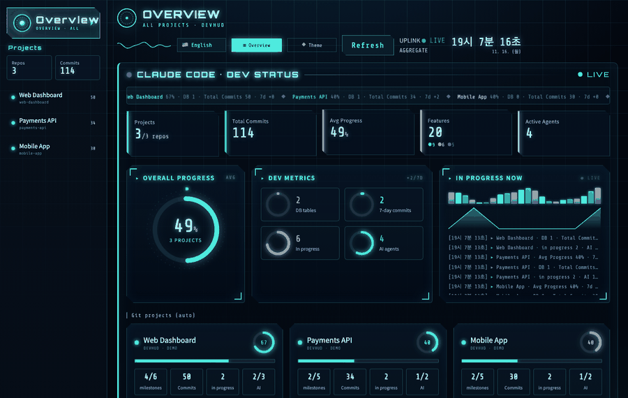

<div align="center">

# Mission Control — DevHUD

**A sci‑fi mission‑control HUD for your project's live development status.**
Point it at any git repo. See milestones, velocity, work distribution — plus a **live feed of what you're actually building right now** (topics, files changed with ±lines, DB tables, modules) read from your local Claude Code session logs. 100% local, zero dependencies, no secrets.



</div>

---

## Why

Most "git dashboards" show GitHub traffic (clones/stars). System HUDs show CPU/RAM. **Mission Control shows your project's _development status_** — how far along, what's moving, where the work is going — in a cinematic HUD you can keep open on a second screen.

- 🛰 **Zero‑config, auto‑detected** — point it at a repo and it derives **milestones** (repo maturity: docs/tests/CI/container/releases), **phases** (setup & quality completeness), **feature status** (modules by recent activity), **tech stack**, **code composition** and **contributors**. Set any of these in config only when you want exact values — config overrides auto.
- 🛰 **Live activity — what you're building _right now_** — reads your local **Claude Code** session logs (`~/.claude/projects`) and shows, per session, the real **topics** you're working on, recent **actions** (edit / write / run), and **files changed with ±line counts**. The Overview adds a **live file-change stream** (`analytics.tsx +144 −12`) and a scrolling **dev-artifact console** of what the code actually contains — DB tables, module structure, screens, docs. All local, all real; topic text can be hidden with `"activityTopics": false`.
- 🧾 **Real token usage** — a **Claude Code** panel reads those same session logs for actual input/output/cache tokens and sessions per folder. An optional **Anthropic API** panel pulls real tokens + USD cost from the official Usage/Cost API when you add an Admin key (local, git-ignored) — otherwise it shows a setup card.
- 🗂 **My Projects board (opt-in, off by default)** — the zero-config experience is **100% automatic**; nothing to type. If you *want* a manual card board for non-git work (planning, ops), copy `my-projects.sample.json` → `my-projects.json` (git-ignored) and it appears in the Overview. Each card auto-derives an activity score/status from its last-activity date.
- 📈 **Commit activity (14d)** — momentum at a glance.
- 🧩 **Work distribution** — tallies commit tags (`[area]` or `feat:` / `fix:` …) so you see where effort goes.
- 🌿 **Branches, TODO/FIXME, contributors, pages, files** — live counts.
- 🎯 **Cinematic Overview** — an aggregate deck across all your projects: an animated progress reactor, per-metric rings that cycle project-by-project then to the total, commit radar and an event stream. The flashy motion is deliberately cosmetic; every number is real.
- 🌍 **6 languages** (EN / KO / VI / JA / ES / ZH) and **4 themes** (cyan / amber / matrix / magenta), one‑click switch.
- 🔒 **Local & private** — reads git structure and local session logs only, binds to `127.0.0.1`, **never reads `.env`, keys or tokens**, and sends nothing anywhere.

## Quick start

```bash
git clone https://github.com/<you>/mission-control.git
cd mission-control
cp config.sample.json config.json      # then edit "repo" to point at your project
python3 server.py                      # no pip install, stdlib only
```

Open **http://127.0.0.1:8799** → done. (Requires `git` + Python 3.8+.)

## Configuration (`config.json`)

| Key | Meaning |
|---|---|
| `project` / `tagline` | Header text |
| `repo` | Absolute path to the git repo to watch (empty = this repo) |
| `subpath` | Monorepo support: scope a project to a subfolder (e.g. `apps/web`). All metrics are filtered to that path, so one repo can appear as several projects |
| `branch` | Branch/ref to read (empty = current `HEAD`); set `"fetch": true` to pull it first |
| `theme` | `cyan` · `amber` · `matrix` · `magenta` |
| `port` | Local port (default `8799`) |
| `areaRegex` | How to extract a "work area" from a commit subject |
| `milestones[]` | `{name, done}` or `{name, detectFile}` / `{name, detectCommit}` |
| `panels{}` | Toggle any panel on/off |
| `recs[]` | Optional "recommended next actions" list |
| `claudeProjectsDir` | Where to read Claude Code session logs (default `~/.claude/projects`) |
| `activityTopics` | `false` hides prompt/topic text in the activity feed; actions & file changes still show (default `true`) |
| `anthropicAdminKey` | Optional Admin API key for the real tokens + cost panel (local, git‑ignored) |

Every field is optional. With no `milestones` / `phases` / `features` / `agents`, those panels are **auto-derived from git** — so a new repo looks complete with zero setup.

> Your `config.json` is **git‑ignored** — keep a private config that points at your repos, publish only `config.sample.json`.

## How it works

A tiny stdlib Python server runs `git` read‑only commands in your repo and reads your local Claude Code session logs (JSON line files — message text, tool calls, token counts), then serves a single HTML HUD that polls `/api/status`, `/api/overview` and `/api/activity`. Everything stays on your machine. There is no telemetry, no account, no cloud.

## License

MIT — see [LICENSE](LICENSE). Contributions welcome.
