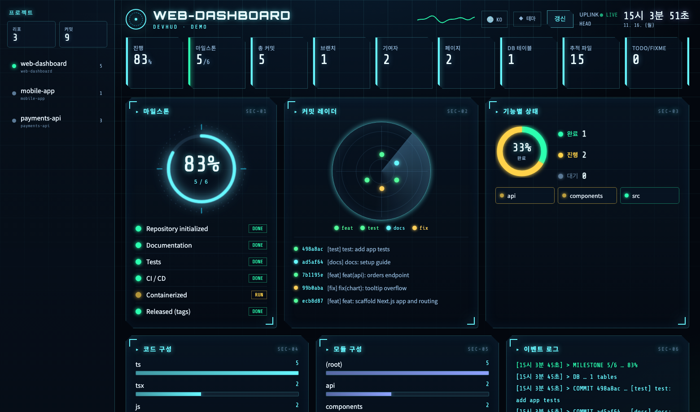

<div align="center">

# Mission Control — DevHUD

**A sci‑fi mission‑control HUD for your project's live development status.**
Point it at any git repo. See milestones, velocity, work distribution, branches and recent commits as a cinematic heads‑up display. 100% local, zero dependencies, no secrets.



</div>

---

## Why

Most "git dashboards" show GitHub traffic (clones/stars). System HUDs show CPU/RAM. **Mission Control shows your project's _development status_** — how far along, what's moving, where the work is going — in a cinematic HUD you can keep open on a second screen.

- 🛰 **Zero‑config, auto‑detected** — point it at a repo and it derives **milestones** (repo maturity: docs/tests/CI/container/releases), **phases** (setup & quality completeness), **feature status** (modules by recent activity), **tech stack**, **code composition** and **contributors**. Set any of these in config only when you want exact values — config overrides auto.
- 📈 **Commit activity (14d)** — momentum at a glance.
- 🧩 **Work distribution** — tallies commit tags (`[area]` or `feat:` / `fix:` …) so you see where effort goes.
- 🌿 **Branches, TODO/FIXME, contributors, pages, files** — live counts.
- 🎯 **Commit radar + event‑log stream** — the fun sci‑fi bits.
- 🎨 **4 themes** (cyan / amber / matrix / magenta), one‑click switch.
- 🔒 **Local & private** — reads git structure only, binds to `127.0.0.1`, **never reads `.env`, keys or tokens.**

## Quick start

```bash
git clone https://github.com/<you>/mission-control.git
cd mission-control
cp config.sample.json config.json      # then edit "repo" to point at your project
python3 server.py                      # no pip install, stdlib only
```

Open **http://127.0.0.1:8799** → done. (Requires `git` + Python 3.8+.)

## Configuration (`config.json`)

| Key | Meaning |
|---|---|
| `project` / `tagline` | Header text |
| `repo` | Absolute path to the git repo to watch (empty = this repo) |
| `subpath` | Monorepo support: scope a project to a subfolder (e.g. `apps/web`). All metrics are filtered to that path, so one repo can appear as several projects |
| `branch` | Branch/ref to read (empty = current `HEAD`); set `"fetch": true` to pull it first |
| `theme` | `cyan` · `amber` · `matrix` · `magenta` |
| `port` | Local port (default `8799`) |
| `areaRegex` | How to extract a "work area" from a commit subject |
| `milestones[]` | `{name, done}` or `{name, detectFile}` / `{name, detectCommit}` |
| `panels{}` | Toggle any panel on/off |
| `recs[]` | Optional "recommended next actions" list |

Every field is optional. With no `milestones` / `phases` / `features` / `agents`, those panels are **auto-derived from git** — so a new repo looks complete with zero setup.

> Your `config.json` is **git‑ignored** — keep a private config that points at your repos, publish only `config.sample.json`.

## How it works

A tiny stdlib Python server runs `git` read‑only commands in your repo and serves a single HTML HUD that polls `/api/status`. Everything stays on your machine. There is no telemetry, no account, no cloud.

## License

MIT — see [LICENSE](LICENSE). Contributions welcome.
